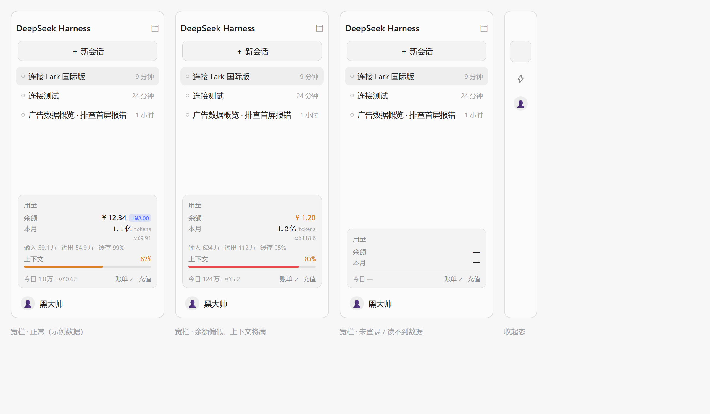

# dsh-usage-card · 侧边栏余额 / 用量卡片

在 DSH 侧边栏底部（会话列表和账号行之间的空白处）加一张小卡片，随时看到：



| 行 | 内容 | 数据来源 |
| --- | --- | --- |
| 余额 | DeepSeek 平台钱包余额；有赠送额度时并排显示 `+¥x.xx` 胶囊 | `account.getBalance` |
| 本月 | 本月 token 总数 + 预估花费 `≈¥x` | 各会话 `tokenUsage` 投影 + 内置单价表 |
| 明细 | 输入 / 输出 / 缓存命中率（悬停看完整拆分与单价口径） | 同上 |
| 上下文 | 当前打开的会话占模型窗口的比例，2px 水位条；≥60% 琥珀、≥80% 红 | `contextPressure` 投影 |
| 今日 | 今天消耗的 token + 预估花费 | 同上 |
| 链接 | `账单 ↗` 打开平台用量页，`充值` 打开充值页 | `account.getState().links` |

余额低于 ¥10 变琥珀色、低于 ¥2 变红色；侧边栏收起时卡片缩成一个闪电图标，余额告急时图标上带红点。鼠标移到卡片上，右上角出现刷新按钮；卡片每 2 分钟自动刷新一次。

## 金额是怎么估的

按会话读出它用的模型（`modelSelection`），套 DeepSeek 官方[模型价格页](https://api-docs.deepseek.com/zh-cn/quick_start/pricing)的**峰时**单价（元 / 百万 tokens，2026-10 核对）：

| 模型 | 缓存命中 | 缓存未命中 | 输出 |
| --- | --- | --- | --- |
| `deepseek-flash` | 0.04 | 2 | 8 |
| `deepseek-v4-pro` | 0.30 | 9 | 27 |

- 缓存写入按未命中计价（DeepSeek 不收单独的写入费）；
- 谷时是峰时的一半，所以这个数字是**上限**；月总里无法按小时拆分，就统一按峰时算；
- 模型没公开单价、或走的不是 DeepSeek 官方路由（`provider` 不以 `deepseek` 开头）时**不显示金额**，而不是编一个；
- 只算 token，不含搜索/抓取等按次计费项；真实账单以 `账单` 页为准。

改价：`lib/client.js` 顶部的 `PRICING` 表，加一行即可。

## 口径与边界

- **按会话归属**：一个会话算进它「最后活跃」的月份/日期。跨月还在继续用的长会话，整段消耗都会算进本月（偏大）。日常一两个会话完结的用法，结果与真实月度用量一致。
- **只统计本机会话**：数字来自 `~/.dsh/sessions` 里能被 Host 读到的会话投影，不请求平台账单接口（平台没有开放余额以外的用量查询）。平台侧真实的账期口径以 `账单` 页为准。
- **缓存**：每个会话的累计 token + 模型以 `(sessionId, updatedAt)` 为键存在 `localStorage`，刷新只重读有变化（`updatedAt` 变了）的会话，所以刷新很快。
- **上下文水位**读的是主视图当前选中的会话（工作区把选择存在 `dsh.sessions.current` 里），没开会话时这一行不显示。

## 安装 / 卸载

仓库：<https://github.com/bujiawen597/dsh-usage-card>（private）

三种装法、注意事项都写在 [INSTALL.md](INSTALL.md)。最省事的两种：

- **从仓库装**：那台 DSH → Plugins → Add plugin → 填
  `git+https://github.com/bujiawen597/dsh-usage-card.git`（private 仓库需要那台机器也 `gh auth login` 过）。
- **从压缩包装**：把 `dsh-usage-card-0.1.0.tgz` 拷过去，Plugins → Add plugin → 填 tgz 的绝对路径。

本机目前是 `link:` 到本目录的安装，所以改代码后：

1. 在 **Plugins** 页面把本插件关掉再打开（或重启 DSH），浏览器会拉取新的 bundle；
2. 页面无需重启 Host。

卸载：Plugins 页面里移除 `dsh-usage-card`，或在会话里让 agent 调用
`plugin_manager` 的 `remove_bundle`，目标名 `dsh-usage-card`。
⚠️ `link:` 安装时移除插件会顺着 junction 清空本目录，移除前先备份（见 INSTALL.md）。

## 结构

```
lib/index.js        Host 半：空 apply，只为占一个 Loader 行（bundle 身份）
lib/client.js       浏览器半：整个卡片（样式、文案、取数、渲染）
cordis.patch.yml    bundle patch：插入 usage-card 这一行
test/smoke.mjs      无浏览器冒烟测试：假 window/react/服务，跑两遍渲染
preview/build.mjs   用真实样式表生成静态预览 preview/card-light.html
```

## 自定义

- 刷新间隔：`lib/client.js` 里的 `REFRESH_MS`（默认 120000ms）。
- 预警阈值：`UsageCard` 里 `wallet.amount < 10` / `< 2`。
- 文案：`TEXT` 里的 `zh` / `en` 两份字典，注册进 `usage-card` 语言命名空间。

## 还能往下加什么

1. **峰谷分时计价**：现在按峰时单价给上限。把每次请求按时间落进峰/谷（含法定节假日表）就能给出更准的金额。
2. **按天迷你趋势**：把每个 turn 的时间戳按天归桶，画 7/30 天柱状图，能看出「今天是不是用猛了」。
3. **余额告警**：低于阈值时弹一次 toast / 桌面通知，而不是只变色。
4. **本月会话数排行**：回答「钱花在哪些会话上」，点进去直接打开那个会话。
5. **额度/限速**：如果平台开放配额查询，补一行「剩余请求额度」。
6. **紧凑模式**：现在 7 行约 170px；给一个只显示「余额 + 本月」的两行版本，窄屏更清爽。
